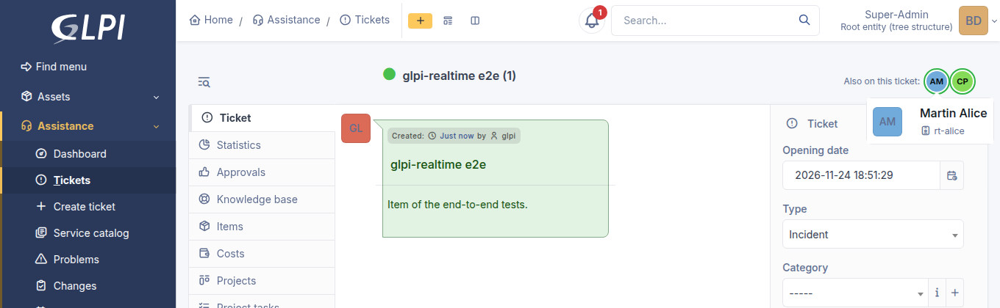
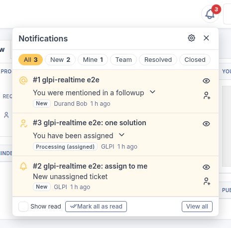
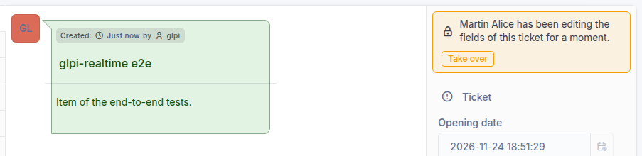
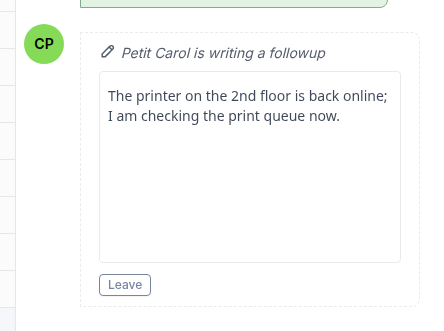
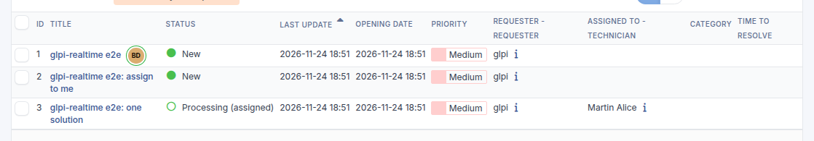
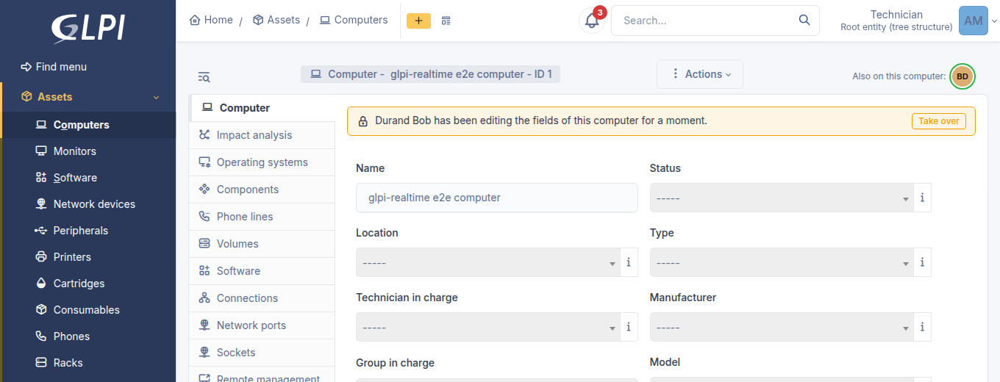
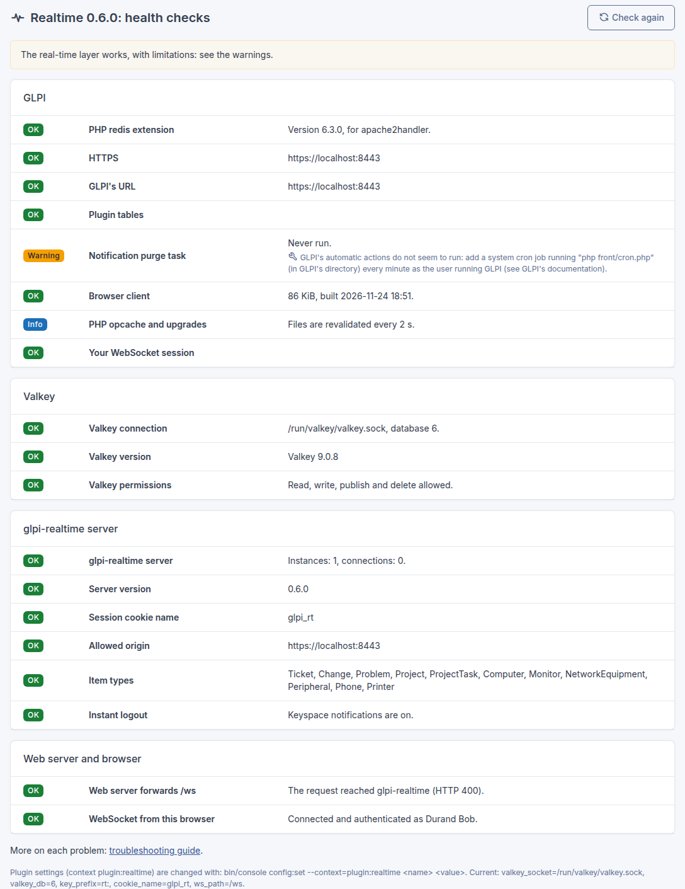
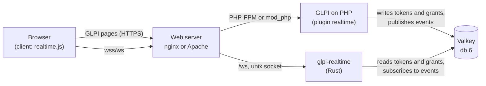

# glpi-realtime

[](https://github.com/0xNath/glpi-realtime/actions/workflows/ci.yml)

Optional real-time layer for GLPI 11 and 12: who is on an item, who is writing, changes
shown live, one editor at a time, and instant notifications.

| | Tickets, changes, problems | Projects, project tasks, assets (and any GLPI item) |
|---|---|---|
| Presence on the item and on the lists (GLPI's avatars and user card) | ✓ | ✓ |
| Single editor of the fields, take over from an inactive tab | ✓ | ✓ |
| GLPI refuses to save a form older than the item | ✓ | ✓ |
| "Refresh" when someone else changed the item | ✓ | ✓ |
| Timeline updated live; who is writing a followup, task or solution | ✓ | |
| Shared answer drafts: follow them live, take them over | ✓ | |
| One solution at a time (enforced by GLPI) | ✓ | |
| Bell: queues, read/unread, assume, preferences, sound, desktop notifications | ✓ | project tasks |
| Mentions ("@name") notified at once | ✓ | |

GLPI works unchanged when the server, Valkey or the plugin is absent. Documentation:
[install](#install), [troubleshooting](docs/troubleshooting.md),
[security model](docs/security.md), [protocol](docs/protocol.md),
[changes](CHANGELOG.md).

| | |
|---|---|
|  |  |
| Who else is on the item, with GLPI's user card on hover | Notifications, mentions included: queues, read/unread, assume |
|  |  |
| One editor of the fields at a time | Who is writing, and their draft followed live |
|  |  |
| Who is on each row of the lists | Assets and projects: presence and one editor |
|  | |
| Checks of the whole setup, with how to fix | |

## Architecture



## Performance

Measured with the load test tool on one machine (16 threads, server as its own process,
Valkey on a unix socket, version 0.4.0):

| | 20 000 connections on 2 000 items |
|---|---|
| Connecting all of them | 1.6 s, no failure; handshake + subscription p99 122 ms |
| One event in every item, published at once | all delivered, p99 149 ms |
| One newcomer in every item | every member told, p99 389 ms |
| Server memory | 541 MiB (≈ 25 KiB per connection) |
| Server CPU for the whole run | 10 s |

```bash
cd server && cargo run --release --example loadtest -- --valkey unix:///path/to/valkey.sock \
    --connections 20000 --rooms 2000 [--addr 127.0.0.1:8090]   # without --addr: starts its own server
```

It uses Valkey db 6 with the `rt:` prefix (sessions `rt:s:5eed…`) and removes its keys at
the end: point it to a test Valkey, not production's.

## Install

Requirements: GLPI 11 or 12 with the PHP `redis` extension (phpredis), Valkey ≥ 9.0 (or
Redis ≥ 7.4), systemd, nginx or Apache httpd ≥ 2.4.47, HTTPS. Linux on x86_64 or aarch64
(the server is a static binary).

The project never writes configuration: the files of steps 3 to 5 are yours, set up once
from `deploy/examples/`, and upgrades never touch them.

### 1. Download a release

From [Releases](https://github.com/0xNath/glpi-realtime/releases):

```bash
VERSION=0.6.0 ARCH=$(uname -m)                  # x86_64 or aarch64
BASE=https://github.com/0xNath/glpi-realtime/releases/download/v$VERSION
curl -LO "$BASE/glpi-realtime-$VERSION-linux-$ARCH.tar.gz" -LO "$BASE/SHA256SUMS"
sha256sum --check --ignore-missing SHA256SUMS
tar xzf "glpi-realtime-$VERSION-linux-$ARCH.tar.gz" && cd "glpi-realtime-$VERSION"
```

Archives are built by the CI, with a provenance attestation you can verify with GitHub's
CLI: `gh attestation verify glpi-realtime-$VERSION-linux-$ARCH.tar.gz --repo 0xNath/glpi-realtime`.

It holds the server (`bin/`), the GLPI plugin (`plugin/`), `deploy/` and the docs.
`glpi-plugin-realtime-<version>.tar.bz2` is the plugin alone, for `<GLPI>/plugins/`.

### 2. Install the files (also for every upgrade)

```bash
sudo GLPI_DIR=/var/www/glpi PHP=php8.3 RELOAD_PHP="systemctl reload php8.3-fpm" deploy/install.sh
```

It installs the binary in `/usr/local/bin`, copies the plugin into
`$GLPI_DIR/plugins/realtime`, installs or upgrades it in GLPI (tables, cron task; settings
are kept) and activates it, restarts the `glpi-realtime` service if there is one, and ends
with the checks of step 6 (errors are expected on a first install, before steps 3 to 5).

| Setting | Default | |
|---|---|---|
| `GLPI_DIR` | `/var/www/glpi` | GLPI's directory (holds `bin/console`) |
| `PHP` | `php` | PHP command line, e.g. `php8.3` |
| `RELOAD_PHP` | — | reloads GLPI's PHP after the copy, e.g. `systemctl reload php8.3-fpm` or `systemctl reload apache2` (mod_php); without it the script waits 65 s for PHP's opcache to see the new files |
| `PREFIX` | `/usr/local` | the binary goes to `$PREFIX/bin` |
| `GLPI_USER` | owner of `$GLPI_DIR/files` | user running GLPI's console |
| `SERVICE` | `glpi-realtime` | systemd unit restarted |
| `CHECK` | `1` | `0`: skip the final checks |

### 3. Server: user, configuration, service (once)

```bash
sudo useradd --system --no-create-home --shell /usr/sbin/nologin glpi-realtime
sudo install -d -m 750 -o root -g glpi-realtime /etc/glpi-realtime
sudo install -m 640 -o root -g glpi-realtime deploy/examples/config.toml.example /etc/glpi-realtime/config.toml
sudoedit /etc/glpi-realtime/config.toml      # allowed_origins, listen.group, valkey.url, allowed_itemtypes
glpi-realtime --config /etc/glpi-realtime/config.toml --check

sudo cp deploy/examples/glpi-realtime.service /etc/systemd/system/
sudoedit /etc/systemd/system/glpi-realtime.service   # SupplementaryGroups
sudo systemctl daemon-reload && sudo systemctl enable --now glpi-realtime
```

- `allowed_origins`: GLPI's address, e.g. `["https://glpi.example.org"]`.
- `allowed_itemtypes`: the item types with real-time features, the same as the plugin's
  `enabled_itemtypes` ([Item types](#item-types)); the example lists the defaults.
- `listen.group` and the unit's `SupplementaryGroups`: the web server's group
  (Debian/Ubuntu: `www-data`, RHEL/Fedora: `nginx` or `apache`), so that only it can open
  the socket (`0660`); add Valkey's socket group to `SupplementaryGroups`.
- The unit is sandboxed (no capabilities, read-only system, syscall filter) and allows
  20 000 connections.

### 4. Valkey (once)

Start from [`deploy/examples/valkey.conf.example`](deploy/examples/valkey.conf.example):

- a unix socket readable by its group: add the `glpi-realtime` user and the user running
  PHP to that group;
- `notify-keyspace-events Kgx`, for instant revocation at logout (without it, set
  `revocation.keyspace_events = false` in `config.toml`: sessions are checked every 15 s);
- an ACL user limited to the `rt:*` keys and channels: whoever can write to Valkey can
  forge sessions.

Give that user's password to the server (`config.toml`: `[valkey] username`, `password`)
and to GLPI (stored encrypted with GLPI's key):

```bash
cd /var/www/glpi       # as the user running GLPI (here www-data)
sudo -u www-data php bin/console config:set --context=plugin:realtime valkey_username glpi-rt
sudo -u www-data php bin/console config:set --context=plugin:realtime valkey_password '…'
```

The plugin's other settings (`valkey_socket`, `valkey_db`, `key_prefix`, `cookie_name`)
default to the values of `config.toml.example`: change both sides together
([Configuration](#configuration)).

### 5. Web server (once)

The browser opens `wss://<glpi-host>/ws`: the GLPI vhost proxies that path to the
server's unix socket, with WebSocket upgrade and long timeouts. Full examples:
[`deploy/examples/nginx-glpi.conf`](deploy/examples/nginx-glpi.conf) and
[`deploy/examples/apache-glpi.conf`](deploy/examples/apache-glpi.conf).

nginx, inside the GLPI `server` block (plus the `upstream` and `limit_req_zone` at http
level, see the example):

```nginx
location = /ws {
    limit_req zone=glpi_ws burst=20 nodelay;
    proxy_pass http://glpi_realtime;              # upstream: unix:/run/glpi-realtime/rt.sock
    proxy_http_version 1.1;
    proxy_set_header Upgrade    $http_upgrade;
    proxy_set_header Connection "upgrade";
    proxy_set_header Host       $host;
    proxy_read_timeout 1h;
    proxy_send_timeout 1h;
    proxy_buffering off;
}
```

Apache httpd ≥ 2.4.47 (`proxy`, `proxy_http`), inside the GLPI `VirtualHost`:

```apache
ProxyPass "/ws" "unix:/run/glpi-realtime/rt.sock|http://localhost/ws" upgrade=websocket timeout=3600
ProxyPreserveHost On
```

For 20 000 WebSockets, raise the web server's limits (nginx: `worker_rlimit_nofile`,
`worker_connections`; Apache event MPM: `MaxRequestWorkers` and related), as noted in the
examples.

### 6. Check

**Setup > Plugins > Realtime** (the plugin's configuration page, for users who may
change GLPI's configuration) checks everything the real-time layer needs and says how to
fix what is missing: PHP's redis extension, HTTPS, the plugin's tables and cron task, the
client bundle; Valkey (connection, ACL login, version, permissions); the server instances
(each publishes its status in Valkey: version, cookie name, allowed origins and item
types, keyspace notifications), compared with GLPI's settings; and, from the browser, the
web server's `/ws` location and a real WebSocket.

The same checks from the command line, for scripts and monitoring (run as the user
running GLPI; `deploy/install.sh` runs it at the end, `CHECK=0` to skip):

```bash
php bin/console plugins:realtime:check            # [--format=json] [--no-web]
```

The web server is checked through GLPI's URL (as browsers reach it): `/ws` must reach the
server, and a WebSocket upgrade must get through with GLPI's origin. Exit code, as
monitoring tools expect it: 0 everything works, 1 warnings, 2 errors.

Something wrong? [docs/troubleshooting.md](docs/troubleshooting.md) explains the usual
causes.

### Upgrading

Download the new release (step 1) and run step 2 again. Configuration is never changed
by an upgrade; [CHANGELOG.md](CHANGELOG.md) says when you have to edit it, e.g.:

- **0.6.0**: projects, project tasks and assets get presence and a single editor; an
  existing install keeps its item types (the checks list what is available). To enable
  them, on both sides (as the user running GLPI, in GLPI's directory):

  ```bash
  php bin/console config:set --context=plugin:realtime enabled_itemtypes \
    '["Ticket","Change","Problem","Project","ProjectTask","Computer","Monitor","NetworkEquipment","Peripheral","Phone","Printer"]'
  ```

  and the same list in `config.toml`, `[security] allowed_itemtypes`, then restart the
  server.
- **0.3.0**: add `"Change", "Problem"` to `security.allowed_itemtypes` in `config.toml`.

## Build and test

- `server/`: WebSocket server in Rust (tokio, axum, fred/Valkey).
- `plugin/`: GLPI plugin `realtime` (PHP): issues session tokens and per-item grants.
- `client/`: browser client in TypeScript, bundled into `plugin/public/realtime.js`.
- `deploy/`: `install.sh` (installs and upgrades the binary and the plugin), and
  `examples/`: configuration, systemd unit, system user, Valkey, nginx and Apache vhosts.
- `e2e/`: end-to-end tests in a real Chromium, against your GLPI or a disposable one
  (`e2e/env/`, containers) ([setup](e2e/README.md)).
- `docs/`: protocol, security model, troubleshooting; `docs/img/`: the screenshots.

Requirements: Rust ≥ 1.85, Node ≥ 22.6, `valkey-server` (integration tests),
`php-legacy` with the `redis` extension (plugin and interop tests).

```bash
./scripts/test-all.sh          # Rust unit + integration, PHP plugin, client
(cd server && cargo build --release)
(cd client && npm ci && npm run build)
```

End-to-end, against a disposable GLPI in containers (Docker or Podman; any
`docker.io/glpi/glpi` tag with `GLPI_VERSION`):

```bash
e2e/env/up.sh && (cd e2e && npm ci && E2E_ENV_FILE=../.e2e.local.env npx playwright test)
e2e/env/down.sh
```

The CI runs them on GLPI 11.0, 12.0.0 and the latest 12.0, after an upgrade from the
previous release (`UPGRADE_FROM`), and, as warnings only, on the next 12.0 and GLPI's main
branch. They include accessibility checks (axe-core, WCAG 2.1 AA) of the real-time
layer's elements. The README's screenshots come from the same environment:
`npx playwright test --config screenshots.config.ts` in `e2e/`.

Release archives (what users install): `scripts/release.sh` builds
`dist/glpi-realtime-<version>-linux-<arch>.tar.gz` (static binary when the
`x86_64-unknown-linux-musl` target is installed, plugin, `deploy/`, docs),
`dist/glpi-plugin-realtime-<version>.tar.bz2` and `SHA256SUMS`. The CI publishes them for
`v*` tags, once every suite, the dependency audits and the end-to-end tests pass.
`deploy/install.sh` also works from a built repository.

## Configuration

See [`deploy/examples/config.toml.example`](deploy/examples/config.toml.example). Each value can be overridden
with `GLPI_RT_<SECTION>__<KEY>`. Plugin settings (Valkey socket and db, key prefix, cookie
name, enabled item types) are in GLPI's configuration table, context `plugin:realtime`,
and must match the server.

### Item types

`enabled_itemtypes` (plugin) and `[security] allowed_itemtypes` (server) list the same
classes; the checks warn while they differ. Default: tickets, changes, problems, projects,
project tasks, computers, monitors, network devices, peripherals, phones and printers.
Tickets, changes and problems get every feature; any other GLPI item with a standard form
gets presence and the single editor of its form, custom assets of GLPI 11+ included, by
class (e.g. `Glpi\CustomAsset\ServerAsset`).

### Mentions

Mentions are GLPI's: typing "@" in a description, followup, task, solution or approval
offers the users to mention, if the author's profile allows it (Administration >
Profiles > a profile > Assistance, "Mentions configuration"). GLPI makes the mentioned
users observers and mails them; the bell tells them at once, unless they turned off
"When I am mentioned (@)" in its preferences.

## Translations

- Plugin messages: GLPI's gettext, domain `realtime` (`plugin/locales/*.po`, compiled
  `.mo`). Maintainers: `scripts/i18n.py` extracts the strings and compiles.
- Browser texts: French and English are built in. Any other language:
  `cd client && npm run i18n-template` writes `plugin/locales/client-template.json`; copy it
  to `plugin/locales/client/<lang>.json` (`de_DE.json` or `de.json`, after GLPI's language codes), translate
  the texts (`{0}`, `{1}`… are values), and deploy: no rebuild.

Translators can also work on a hosted Weblate (e.g. hosted.weblate.org, free for libre
projects), set up by a maintainer with two components on this repository:

| Component | File format | File mask | Template |
|---|---|---|---|
| Plugin | gettext PO | `plugin/locales/*.po` | `plugin/locales/realtime.pot` |
| Browser | JSON nested structure | `plugin/locales/client/*.json` | `plugin/locales/client-template.json` |

with the "Compile MO files" add-on on the first one. Weblate opens pull requests; the CI
checks that the template matches the sources (`scripts/i18n.py --check`).

## Operations

- Health: `curl --unix-socket /run/glpi-realtime/rt.sock http://localhost/health`
- Metrics (Prometheus): `.../metrics` — `rt_connections`, `rt_handshakes_total{result}`,
  `rt_messages_in_total`, `rt_messages_out_total`, `rt_errors_total{code}`,
  `rt_disconnects_total{reason}`, `rt_revocations_total`, `rt_events_total`,
  `rt_events_rejected_total`.
- Browser debug: `localStorage.setItem('glpi-realtime-debug', '1')`, then reload.
